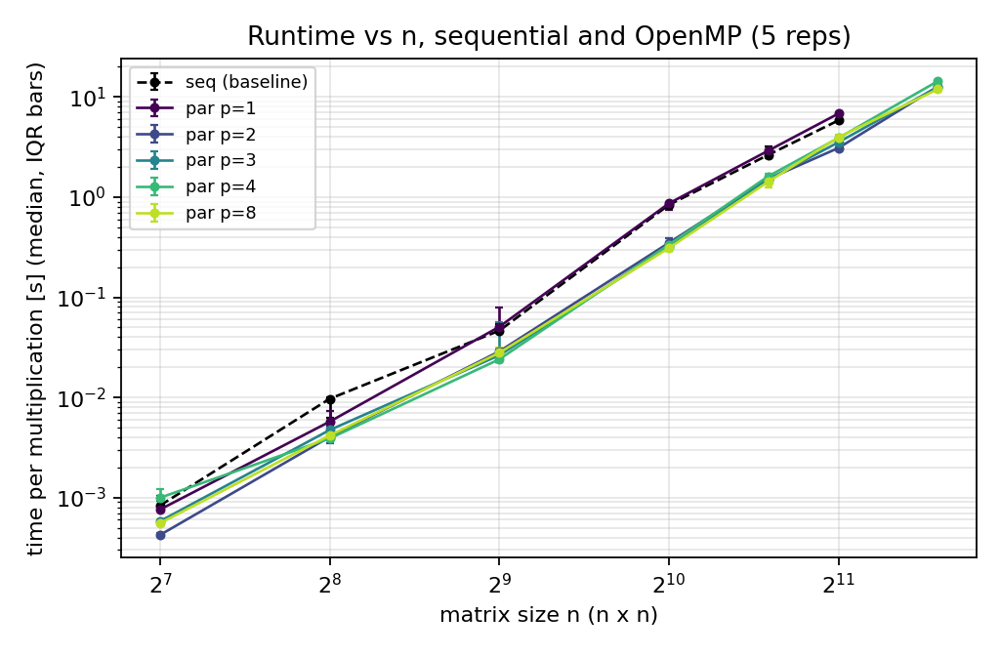
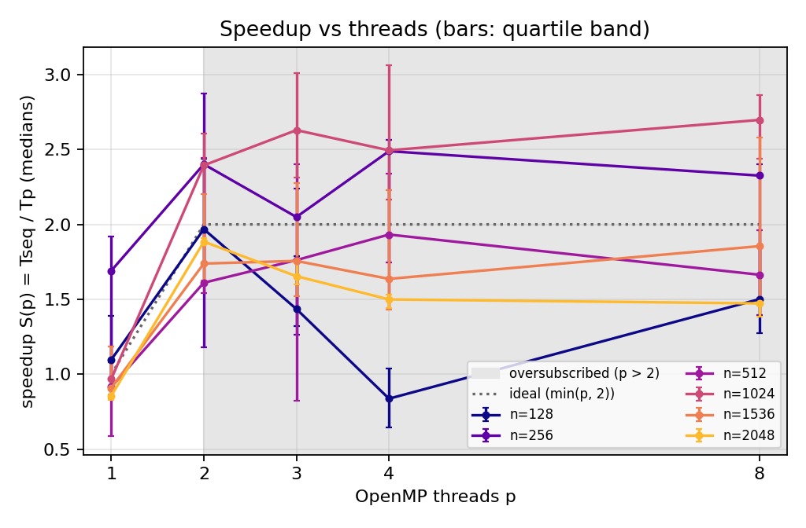

# Assignment 3 — Parallel Dense Matrix Multiplication with OpenMP: How Thread Count Affects Performance

<p class="meta">Big Data · Grado en Ciencia e Ingeniería de Datos · ULPGC 2026-2027 · Individual Assignment 3 · Andrea Patruno · November 2026</p>

<p class="meta">GitHub repository (code, raw data, scripts): <a href="https://github.com/andreapatruno1/Assignment3_BD">https://github.com/andreapatruno1/Assignment3_BD</a></p>

**Abstract.** We ask how the number of OpenMP threads p changes the runtime of a shared-memory dense multiplication, and when parallel execution helps. The validated i-k-j kernel of Assignment 2 is the sequential baseline; the parallel version splits the rows of C among p threads with the same code. On a virtual machine with 2 logical processors we test p = 1, 2, 3, 4, 8 for n = 128–3072 (median of 5 repetitions). Results are bitwise identical for every p. Two threads give a speedup of 1.6–2.0 from n = 128 upwards (1.88 with a narrow band at n = 2048, efficiency 0.94); more threads than logical processors never help reliably and cost 14–28 % at n = 2048. Some apparent superlinear speedups (up to 2.7) are shown to be variability of the single-thread baseline, not a real effect. Conclusions are limited to this 2-vCPU environment.

## 1. Introduction and objective

Assignments 1–2 reduced the cost per arithmetic operation of one thread (loop order, blocking). The next step in the course (*Block 2: Parallel Programming*) is to use more than one execution context at the same time [1]. Matrix multiplication is a natural candidate: every row of C can be computed independently.

**Research question.** How does the thread count p affect the runtime, speedup, efficiency and memory of an OpenMP matrix multiplication, compared with its equivalent sequential version, and for which sizes and thread counts does parallel execution help on the available hardware?

**Hypotheses (stated before measuring).** H1: with p = 2 (= logical processors) the speedup approaches 2 for large n but is lower for small n, where the cost of creating and joining the threads is comparable to the work. H2: p > 2 (oversubscription) gives no further gain and may lose time. H3: the parallel code with one thread costs the same as the sequential code (negligible framework overhead).

*Factors changed:* p and n. *Outcomes:* time per multiplication, S(p), E(p), peak memory.

## 2. Background

**Speedup and efficiency.** With Tseq(n) the time of the sequential baseline and Tp(n) the time of the parallel version with p threads on the same input, S(p) = Tseq(n) / Tp(n) and E(p) = S(p) / p. In this report **both times are medians** of 5 repetitions. Amdahl's law [2] bounds S(p) by the sequential fraction; here the parallel loop covers the whole kernel, so the practical bound is the number of execution contexts that really run at the same time: S(p) ≤ min(p, 2) on this machine.

**OpenMP.** `#pragma omp parallel for` creates a team of threads (fork), divides the iterations of the loop among them and waits for all at an implicit barrier (join) [3]. With `schedule(static)` and no chunk size, thread t gets one contiguous block of about n/p iterations. Thread count is set with `omp_set_num_threads` / `OMP_NUM_THREADS`; `OMP_DYNAMIC=false` forbids the runtime from using fewer threads [3]. When p exceeds the hardware contexts, the operating system time-shares the threads (oversubscription).

**Superlinear speedup** (S(p) > p) can be real when the per-thread working set fits in a cache that the sequential run does not fit in, but it is also a classic symptom of an unstable baseline; it must be checked rather than reported as is [4].

## 3. Methodology

### 3.1 Implementations (`src/matmul3.c`, one binary)

Reused material: the i-k-j kernel and the input generator of Assignment 2 (repository `Assignment2_BD`, commit `d7ab62f`), which reuses the Assignment 1 generator [5].

```c
static inline void row_ikj(a, b, c, n, i) {            /* row i of C, i-k-j order (Assignment 2) */
    memset(&c[i*n], 0, n * sizeof(double));
    for (k = 0; k < n; k++) { aik = a[i*n+k]; bk = &b[k*n]; for (j = 0; j < n; j++) c[i*n+j] += aik * bk[j]; }
}
void mm_seq(a, b, c, n) {                               for (i = 0; i < n; i++) row_ikj(a, b, c, n, i); }
void mm_par(a, b, c, n) { #pragma omp parallel for schedule(static)
                                                        for (i = 0; i < n; i++) row_ikj(a, b, c, n, i); }
```

- **seq** (baseline) and **par** execute the *same row body*: same algorithm, numeric type (float64), row-major storage, inputs and order of the k terms for every C[i][j]. The only change from the Assignment 2 kernel is that C is zeroed row by row instead of with one `memset` of the whole matrix (same number of writes), so that both methods are textually the same loop. The compiled inner loops of seq and par are the same 7 scalar instructions (checked with `gcc -S`).
- **Shared data.** A and B are only read; each thread writes only its own rows of C. There are no shared writes, so no locks or atomics are needed and there is no data race by construction. The loop index and the local variables (`aik`, `bk`) are private to each thread.
- **Compiler.** `gcc -O2 -fno-tree-vectorize -fopenmp -std=c11` for both methods (same flags as Assignment 2 plus `-fopenmp`). Vectorisation is disabled so that only the thread count changes; the optional vectorisation extension was **not** undertaken.

### 3.2 Inputs and environment

- **Inputs:** Assignment 1/2 generator, unchanged (`scripts/gen_inputs.py`): NumPy PCG64, seed 42 + n, A then B uniform in [-1, 1), raw little-endian float64 files. n = 128, 256, 512, 1024, 1536, 2048, 3072. All methods read the same files.
- **Hardware and OS:** Intel Core i7-1255U laptop (hybrid CPU: 2 performance + 8 efficiency cores, 12 hardware threads on the host); measurements run in an Ubuntu 22.04.5 Hyper-V virtual machine that exposes **2 logical processors** (reported topology: 1 core × 2 threads, 1 socket, 1 NUMA node), 3.8 GiB RAM, caches L1d 48 KiB, L2 1.25 MiB, L3 12 MiB. Which host cores run the two vCPUs is decided by the host and is not visible from the VM. Same VM as Assignment 2. Details in `results/environment.txt`.
- **Software:** GCC 11.4.0, libgomp (OpenMP 4.5, `_OPENMP = 201511`). Python 3.10.12, NumPy 2.2.6, Matplotlib 3.10.9 for inputs and analysis only.
- **Thread configurations:** p = 1, 2 (within the hardware) and p = 3, 4, 8 (**oversubscribed**: more threads than the 2 logical processors). `OMP_NUM_THREADS = p` and `omp_set_num_threads(p)`, `OMP_DYNAMIC=false`; the program records the team size that actually ran (equal to p in all 200 rows, checked by `analyze.py`). **Affinity:** none — `OMP_PROC_BIND`/`OMP_PLACES` unset, the Linux scheduler places the threads. `OMP_WAIT_POLICY` unset (libgomp default). **Internal library threads:** none; the benchmark process uses no numerical library, so the OpenMP team is the only set of compute threads.

### 3.3 Timing, protocol and budgets

- **Timer boundary (kernel only):** `clock_gettime(CLOCK_MONOTONIC)` around one multiplication. Inside: zeroing of C and, for par, the creation of the parallel region and the final barrier (fork/join is part of the cost of parallelism). Outside: loading the inputs, allocation of C, setting the thread count. For n = 128 a batch of 8 multiplications is timed and the time per multiplication is reported (as in Assignments 1–2). The CPU time of the whole process (all threads) is also read with `CLOCK_PROCESS_CPUTIME_ID` around the same region.
- **Protocol:** 1 warm-up run (not reported) + 5 measured repetitions per configuration; one process per configuration; for each n the seq baseline runs first and then par with every p, so that seq and par of the same n are measured close in time. Every result is consumed by a checksum; all raw values are in `results/raw.csv`. Reported: median and IQR (Q3 − Q1).
- **Speedup band:** besides S(p) from the medians, the range [Q1seq / Q3p, Q3seq / Q1p] is given as a rough indication of how much S could change with the observed spread (not a confidence interval).
- **Budgets (fixed in advance, as in Assignment 2):** 20 s for one multiplication, enforced with `alarm()`; a timeout is recorded in `results/limits.csv`, never as a time. Memory budget 3 GB.
- **Memory metrics:** (1) peak resident set size `VmHWM` of the process (`/proc/self/status`), which includes all threads; (2) analytical array storage 3 · 8n² bytes (A, B, C).
- **Control experiment** (`scripts/check_superlinear.sh`, added after the main sweep to check the unusual values in §4.2): 3 interleaved rounds of seq, seq with a busy loop on the second vCPU, par p = 1 and par p = 2 at n = 1024, and 3 rounds of seq and par p = 1 at n = 2048, same protocol (raw data `results/raw_check.csv`).

### 3.4 Correctness

`matmul3 test` (`results/correctness.csv`, 86 checks, all passed): known 2×2 product; A·I = A and A·0 = 0 for n = 1, 7, 67, 130, 257 (n = 1 < p and sizes not divisible by p; C pre-filled with garbage before A·0) with p = 1, 2, 3, 4, 8; seq against the Assignment 1 i-j-k loop with tolerance 10⁻¹² absolute + 10⁻¹² relative; par against seq with **tolerance 0**. All differences are exactly **0**: each C[i][j] is computed by one thread with the same order of the k terms, so the parallel result is bitwise identical to the sequential one for every p. In the benchmarks all configurations of the same n produce the same checksum (checked by `analyze.py`). Equality across p = 1…8 and across runs is also the practical evidence that there is no race on C.

## 4. Results

### 4.1 Runtime

**Table 1.** Time per multiplication [s], median of 5 repetitions (IQR in brackets).

| n | seq | par p=1 | p=2 | p=3 | p=4 | p=8 |
|---|---|---|---|---|---|---|
| 128 | 0.000835 (0.000257) | 0.000761 (0.000178) | 0.000424 (2.5e-05) | 0.000581 (9.4e-06) | 0.000998 (0.00021) | 0.000556 (5.0e-05) |
| 256 | 0.00969 (0.00371) | 0.00573 (0.00216) | 0.00403 (0.00184) | 0.00473 (0.000497) | 0.00389 (0.000469) | 0.00417 (0.000346) |
| 512 | 0.0464 (0.00846) | 0.0507 (0.028) | 0.0288 (0.00753) | 0.0263 (0.0333) | 0.0240 (0.00308) | 0.0279 (0.00363) |
| 1024 | 0.836 (0.118) | 0.865 (0.136) | 0.349 (0.0543) | 0.318 (0.037) | 0.335 (0.0643) | 0.310 (0.0051) |
| 1536 | 2.63 (0.75) | 2.90 (0.244) | 1.51 (0.0586) | 1.50 (0.208) | 1.61 (0.277) | 1.42 (0.42) |
| 2048 | 5.83 (0.0584) | 6.82 (0.435) | 3.09 (0.0439) | 3.53 (0.271) | 3.89 (0.195) | 3.96 (0.253) |
| 3072 | timeout (> 20 s) | timeout (> 20 s) | 12.7 (0.339) | 12.6 (1.85) | 14.3 (1.44) | 11.9 (2.0) |

<figure><figcaption>Figure 1. Median time per multiplication vs n (log-log), sequential baseline and OpenMP with p threads; bars = IQR. 5 repetitions per point.</figcaption></figure>

**Limits.** Largest size meeting the budget: n = 2048 for seq and par p = 1; n = 3072 for par p = 2, 3, 4, 8. Largest attempted: n = 3072 for every configuration. seq and par p = 1 timed out at n = 3072 (one multiplication > 20 s). The memory budget was never reached (maximum VmHWM 218 MiB).

### 4.2 Speedup and efficiency

**Table 2.** S(p) from medians, [quartile band], / E(p). Shaded columns in Fig. 2 (p = 3, 4, 8) are oversubscribed.

| n | p=1 | p=2 | p=3 | p=4 | p=8 |
|---|---|---|---|---|---|
| 128 | 1.10 [0.84–1.39] / 1.10 | 1.97 [1.73–2.44] / 0.98 | 1.44 [1.32–1.79] / 0.48 | 0.84 [0.64–1.04] / 0.21 | 1.50 [1.28–1.85] / 0.19 |
| 256 | 1.69 [0.85–1.92] / 1.69 | 2.40 [1.18–2.88] / 1.20 | 2.05 [1.27–2.24] / 0.68 | 2.49 [1.44–2.56] / 0.62 | 2.33 [1.39–2.40] / 0.29 |
| 512 | 0.92 [0.59–1.08] / 0.92 | 1.61 [1.54–2.44] / 0.81 | 1.76 [0.82–2.40] / 0.59 | 1.93 [1.74–2.34] / 0.48 | 1.66 [1.46–1.96] / 0.21 |
| 1024 | 0.97 [0.87–1.18] / 0.97 | 2.39 [1.95–2.61] / 1.20 | 2.63 [2.31–3.01] / 0.88 | 2.49 [2.17–3.06] / 0.62 | 2.70 [2.44–2.87] / 0.34 |
| 1536 | 0.91 [0.83–1.18] / 0.91 | 1.74 [1.62–2.20] / 0.87 | 1.76 [1.52–2.27] / 0.59 | 1.64 [1.43–2.23] / 0.41 | 1.85 [1.48–2.58] / 0.23 |
| 2048 | 0.86 [0.83–0.89] / 0.86 | 1.88 [1.87–1.91] / 0.94 | 1.65 [1.60–1.74] / 0.55 | 1.50 [1.44–1.53] / 0.37 | 1.47 [1.39–1.49] / 0.18 |

At n = 3072 Tseq is not available (timeout), so S cannot be computed; since Tseq > 20 s, S(2) > 20 / 12.7 = 1.58 is a lower bound.

<figure><figcaption>Figure 2. Speedup S(p) vs threads for each n; dotted line = ideal min(p, 2); grey area = oversubscription (p > 2 logical processors); bars = quartile band.</figcaption></figure>

**Unusual values.** Table 2 contains values that the code cannot produce: S(1) = 1.69 at n = 256 (seq and par p = 1 run the same instructions on one thread) and S > 2 with only 2 logical processors (n = 256 and 1024). The control experiment checks them (Table 3).

**Table 3.** Control experiment, 3 interleaved rounds × 5 repetitions = 15 values per condition: median [s] (IQR).

| condition | n = 1024 | n = 2048 |
|---|---|---|
| seq | 0.600 (0.146) | 6.75 (1.06) |
| seq + busy loop on the other vCPU | 0.706 (0.120) | – |
| par p = 1 | 0.641 (0.139) | 6.84 (0.677) |
| par p = 2 | 0.329 (0.040) | – |

In these interleaved runs S(2) at n = 1024 is 0.600 / 0.329 = **1.82** (band 1.58–2.24), not 2.39. The seq median is 0.600 s here and 0.836 s in the main sweep: the same code on the same input differs by 39 % between two time windows. Single-thread repetitions are bimodal (≈ 0.55–0.60 s or 0.75–0.98 s, see `results/raw_check.csv`), while p = 2 is much more stable (IQR 12 % vs 24 % of the median).

### 4.3 Memory and CPU use

Peak RSS is the same for every p: it equals the array storage plus ≈ 2 MiB of process overhead (VmHWM 2.3, 8.0, 26.0, 98.0 and 218 MiB for storage 0.38, 6, 24, 96 and 216 MiB at n = 128, 512, 1024, 2048, 3072). Between seq and p = 8 the difference is at most 76 KiB at every n (`results/raw.csv`): each extra thread adds only its stack pages that are actually touched; the matrices are shared, not copied.

The ratio of process CPU time to wall time (average number of busy threads, `results/summary.csv`) is 1.94–2.00 for p = 2 at every n and never above 2.00 for p = 3, 4, 8. For p = 3 at small n it drops to 1.47 (n = 128) and 1.52 (n = 256): one vCPU is idle for part of the run. At n = 2048 the median total CPU time per multiplication is 5.83 s for seq and 6.19 s for p = 2 (+6 %): the two threads together do the same arithmetic with more CPU time.

## 5. Discussion

**Does parallel execution help, and when?** Yes, with p = 2, which is the number of logical processors. Where the measurements are stable (n = 2048, band 1.87–1.91; interleaved n = 1024, 1.82) S(2) = 1.82–1.88, E(2) = 0.91–0.94; the other sizes give 1.61–1.97 with wider bands. Even at n = 128, where one multiplication takes 0.8 ms, the fork/join cost is not visible, so **H1 is only partly confirmed**: the expected loss at small n does not appear for n ≥ 128 (2 million multiply-adds per thread are already much more than the overhead of one parallel region). The limit is the hardware: **beyond 2 threads there is no reliable gain** (H2 confirmed).

**Why S(2) < 2.** The busy-loop test shows that a single thread becomes 18 % slower (0.600 → 0.706 s) when the other vCPU is busy with a loop that does no memory traffic. So the two vCPUs are not independent: they share execution resources or power/frequency budget (the VM reports them as two hardware threads of one core; the exact mapping to the hybrid host CPU is not visible). The +6 % total CPU time at n = 2048 points in the same direction: each thread is slower when both run. A per-thread slowdown of 6–18 % gives S(2) ≈ 2 / 1.06–1.18 = 1.7–1.9, consistent with the measured 1.82–1.88. Memory traffic can also contribute: for every row of C the whole B is streamed (32 MiB at n = 2048, larger than the 12 MiB L3), and two threads share the L3 and the memory bandwidth. Without hardware counters (not readable in the VM, `perf_event_paranoid = 4`) the two causes cannot be separated.

**Superlinear speedups are not real.** The evidence: (1) S(1) = 1.69 at n = 256 with identical code proves that the seq sample of that size was slow, not that par was fast; (2) repeated in interleaved rounds, S(2) at n = 1024 falls from 2.39 to 1.82 because the seq median falls from 0.836 to 0.600 s; (3) the single thread does not become faster when the VM is busier (it becomes slower), so the host does not give the parallel runs a frequency advantage; (4) a cache explanation does not apply to this kernel: splitting rows does not shrink the working set of a thread, because every thread still reads all of B, and both threads see the same L3. The cause is the variability of single-thread runs in this VM between time windows; the bimodal times are compatible with the host moving the vCPU between its fast and slow cores or changing frequency, but this cannot be checked from inside the VM. **Single sweep values of S with a wide band must therefore not be read as precise:** the reliable values are those with narrow bands (n = 2048) and the interleaved check.

**One-thread overhead (H3).** In the interleaved runs par p = 1 is 7 % slower than seq at n = 1024 (0.641 vs 0.600 s, IQRs ≈ 0.14 s) and 1 % slower at n = 2048 (6.84 vs 6.75 s, IQRs 0.68 and 1.06 s): both differences are well inside the spread. The −14 % of S(1) = 0.86 at n = 2048 in the main sweep is not reproduced (1 %), so it was a slow time window for par p = 1. At n = 128 (8 multiplications per sample) par p = 1 was not slower than seq (0.76 vs 0.84 ms). Since the hot loops are the same instructions and one fork/join is of the order of microseconds against 0.8 ms–7 s of work, **H3 is confirmed within the resolution of the measurements** (a few %, not better).

**Oversubscription.** With p > 2 the threads are time-shared on 2 vCPUs. For small n the run (≈ 0.4 ms at n = 128) is shorter than a scheduler time slice, so the static blocks are executed in "rounds": with p = 3 the third block of n/3 rows starts only after one of the first two ends, the wall time is about 2/3 of seq and S ≤ 1.5 — measured 1.44, with CPU/wall = 1.47 confirming that one vCPU waits. p = 4 and p = 8 at n = 128 are erratic (S = 0.84 and 1.50): the cost is dominated by scheduling and by waking sleeping threads, not by the arithmetic. At large n, where the measurements are stable (n = 2048), every extra thread costs time: S = 1.88, 1.65, 1.50, 1.47 for p = 2, 3, 4, 8, while CPU/wall stays at 2.0. Both vCPUs remain busy but do less useful work; context switches between threads that stream different rows (losing cached data) and waiting at the final barrier for the last time-shared thread are plausible causes, not measured ones. At n = 1024–1536 and 3072 the differences between p = 2 and p > 2 are inside the IQR.

**Memory.** Parallelism costs no memory here: the threads share A, B and C, and VmHWM grows by less than 0.1 MiB from 1 to 8 threads. Memory per thread is not a limit for this kernel; the limit at n = 3072 is time, not memory.

**Limitations.** Only 2 logical processors: the study cannot show how S grows beyond 2 or the effect of the host's 10 heterogeneous cores (a run on the host or WSL2 with p up to 12 would be needed). Virtualised environment with no control of host frequency, core type or background load: the same configuration varies by up to 39 % between time windows, which the interleaved control experiment reduces but does not remove. No hardware counters, so cache and bandwidth explanations are not measured. No thread affinity was set. One kernel (i-k-j, scalar); a blocked or vectorised kernel could scale differently.

## 6. Conclusions

Within the tested scope (C, float64, OpenMP i-k-j kernel, 2-vCPU VM): (1) the parallel version gives bitwise identical results to its sequential counterpart for every p; (2) using both logical processors gives S(2) between 1.6 and 2.0 from n = 128 (1.82–1.88, E ≈ 0.91–0.94, where the measurements are most stable), and makes n = 3072 feasible within the 20 s budget; (3) threads beyond the hardware contexts give no reliable benefit and at n = 2048 increase the time by 14–28 %; (4) the OpenMP overhead with one thread is below the measurement resolution; (5) memory use does not depend on p. Apparent superlinear speedups were explained by an unstable single-thread baseline. Unresolved: scaling beyond 2 hardware contexts and on heterogeneous P/E cores, and the share of shared-core contention vs memory bandwidth in the loss from 2 to 1.88.

## References

[1] Course material, *Block 2: Distributed and Parallel Programming — Parallel Programming*, Big Data, ULPGC, 2026. https://mltechdrawer.github.io/BIGDATA/

[2] G. M. Amdahl, "Validity of the single processor approach to achieving large scale computing capabilities," in *Proc. AFIPS Spring Joint Computer Conference*, 1967, pp. 483–485.

[3] OpenMP Architecture Review Board, *OpenMP Application Programming Interface, Version 4.5*, Nov. 2015. https://www.openmp.org/specifications/

[4] T. Hoefler and R. Belli, "Scientific benchmarking of parallel computing systems: twelve ways to tell the masses when reporting performance results," in *Proc. SC '15*, ACM, 2015, Art. 73.

[5] A. Patruno, Assignment 2 — Optimised dense and sparse (CSR) matrix multiplication in C, 2026. https://github.com/andreapatruno1/Assignment2_BD (commit d7ab62f); Assignment 1: https://github.com/andreapatruno1/Assignment1_BD

## Reproducibility materials

Source code, build and run commands (README), thread configurations, raw measurements (`results/raw.csv`, `results/raw_check.csv`), timeouts (`results/limits.csv`), correctness results, environment description and the scripts that produce the tables and figures are in the GitHub repository above.

**Use of generative AI.** AI was used to write the C code and the scripts and help to write this report. All numbers come from the raw CSV files produced by running the code; the author is responsible for checking the code, the results and the references.
